# Architektur – Blickfeld Nord

Die Website der Band Blickfeld Nord (https://blickfeld-nord.de) ist eine **statische Angular-Anwendung ohne eigenen
Server**. Alle Inhalte stehen im Repository. Beim Deploy wird daraus fertiges HTML erzeugt, geprüft und auf GitHub Pages
ausgeliefert. Interaktive Teile (Backstage, Setlist, Formulare) laufen vollständig im Browser.

Ergänzend: [README.md](README.md) (Funktionsübersicht, Entwicklung) und [PFLEGE.md](PFLEGE.md) (Inhalte pflegen ohne Programmierkenntnisse).

## Inhalt

1. [Leitprinzipien](#1-leitprinzipien)
2. [Systemkontext](#2-systemkontext)
3. [Technologie-Stack](#3-technologie-stack)
4. [Aufbau des Quellcodes](#4-aufbau-des-quellcodes)
5. [Routing und Render-Modi](#5-routing-und-render-modi)
6. [Datenmodell – eine Quelle für alles](#6-datenmodell--eine-quelle-für-alles)
7. [Öffentliche Website](#7-öffentliche-website)
8. [Backstage](#8-backstage)
9. [Progressive Web App und Offline](#9-progressive-web-app-und-offline)
10. [Build- und Deploy-Pipeline](#10-build--und-deploy-pipeline)
11. [Qualitätssicherung](#11-qualitätssicherung)
12. [Externe Dienste und Datenschutz](#12-externe-dienste-und-datenschutz)
13. [Pflege-Workflow](#13-pflege-workflow)
14. [Performance](#14-performance)
15. [Architekturentscheidungen](#15-architekturentscheidungen)
16. [Grenzen und bekannte Einschränkungen](#16-grenzen-und-bekannte-einschränkungen)

---

## 1. Leitprinzipien

| Prinzip | Umsetzung |
|---|---|
| **Kein Server, keine Datenbank** | GitHub Pages liefert nur Dateien aus. Formulare erzeugen `mailto:`-Links oder Instagram-Nachrichten, Backstage-Daten liegen im Browser. |
| **Eine Datenquelle** | Mitglieder, Auftritte, Proben, Historie, Fotos und Freunde stehen in `src/app/data/band.service.ts`. Website, SEO-Skript, Kalender und Tests lesen alle daraus. |
| **Vorrendern statt Rendern zur Laufzeit** | Jede öffentliche Seite entsteht beim Build als fertiges HTML (schnell, gut für Google), danach übernimmt Angular im Browser. |
| **Automatisch geprüft vor dem Livegang** | Tests, Barrierefreiheit, Klicktests, Linkcheck und Foto-Prüfung laufen bei jedem Push. Schlägt etwas fehl, bleibt die alte Version online. |
| **Datensparsam** | Keine Cookies, Reichweitenmessung ohne IP-Speicherung, Einbettungen (Instagram) erst nach Klick. |
| **Öffentliches Repo** | Keine Gagen, privaten Adressen oder vollen Namen von Privatleuten. Private Auftritte erscheinen öffentlich nur als „Private Feier“ oder unter ihrem `publicName`. |

## 2. Systemkontext

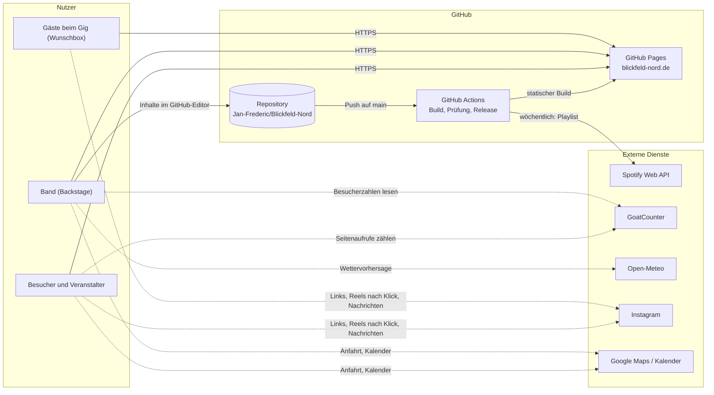

Durchgezogene Pfeile laufen immer, gestrichelte nur bei Bedarf und direkt aus dem Browser. Die Website selbst hat zur
Laufzeit **kein Backend**.

## 3. Technologie-Stack

| Bereich | Technik |
|---|---|
| Framework | Angular 21: Standalone-Komponenten, Signals, ohne zone.js, `@defer` mit inkrementeller Hydration |
| UI | Angular Material (Icons als verkleinerte Icon-Schrift), eigenes SCSS |
| Rendering | `@angular/ssr` mit `outputMode: static` (Prerendering beim Build) |
| Sprache | TypeScript; Build-Skripte in Node.js (ESM) und Python 3.12 |
| Tests | Vitest über `ng test`; Playwright mit axe-core (Barrierefreiheit, Klicktests); Lighthouse CI |
| Hosting | GitHub Pages, Domain `blickfeld-nord.de` |
| CI/CD | GitHub Actions, semantic-release mit Conventional Commits (commitlint), Dependabot |
| Hilfsbibliotheken in Skripten | esbuild (SEO-Skript), fonttools/brotli (Schriften), Pillow (Bilder), reportlab/segno (PDFs, QR-Codes) |

## 4. Aufbau des Quellcodes

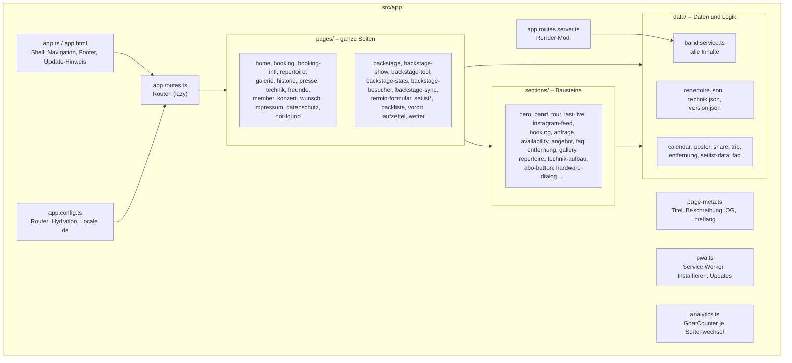

| Ordner / Datei | Aufgabe |
|---|---|
| `src/app/data/` | Inhalte und reine Logik ohne Oberfläche. Wird auch von Build-Skripten und Tests importiert. |
| `src/app/sections/` | Wiederverwendbare Abschnitte (Startseite, Booking, Technik-Aufbau …) |
| `src/app/i18n.ts`, `src/app/content.ts` | Mehrsprachigkeit: Sprache aus der Adresse, Wörterbücher, Inhalts-Übersetzungen |
| `src/app/pages/` | Routen-Komponenten, darunter alle Backstage-Seiten |
| `public/` | Statische Dateien: Fotos (`galerie/`, `historie/`, `band/`), Pressekit und PDFs (`presse/`), Ortsverzeichnis (`data/orte.json`), Icons, Manifest |
| `src/fonts/`, `src/fonts.css` | Auf die benutzten Zeichen verkleinerte Textschriften |
| `scripts/` | Build-, Prüf- und Generator-Skripte (Kapitel 10 und 11) |
| `.github/workflows/` | `deploy-pages.yml` (Release und Deploy), `ci.yml` (Pull Requests), `repertoire.yml` (Spotify-Sync) |

## 5. Routing und Render-Modi

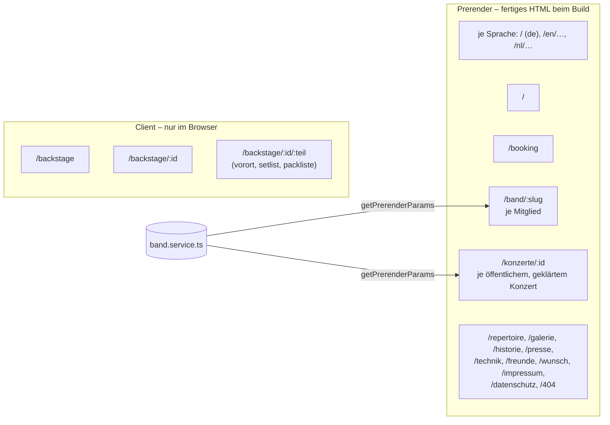

- **Lazy Loading:** Jede Seite außer der Startseite ist ein eigenes JavaScript-Paket (`loadComponent`).
- **Backstage bleibt clientseitig**, damit private Termine nicht als durchsuchbares HTML entstehen. Für Direktaufrufe
  wie `/backstage/2026-12-04/setlist` gibt es keine Datei. Die Fehlerseite `404.html` leitet deshalb zur Backstage-Shell
  weiter (`/backstage/?auftritt=…&teil=…`), die dann zur Unterseite navigiert (Deploy-Schritt „SPA fallback“).
- **Seiten-Metadaten** (`page-meta.ts`, `PageTitleStrategy`): Titel und Beschreibung je Sprache kommen aus `data` der
  Route; `lang`-Attribut, `og:locale`, Canonical und `hreflang`-Verweise ergeben sich aus der Adresse.
- **Frühere Adressen** `/booking/en` und `/booking/nl` leiten auf `/en/booking` bzw. `/nl/booking` weiter.
- **Nach einem Deploy** fehlen eventuell alte JavaScript-Pakete. Dann lädt `reloadOnMissingChunk` die Zielseite einmal
  komplett neu, statt hängen zu bleiben.

### Mehrsprachigkeit

Alle öffentlichen Seiten gibt es auf **Deutsch** (`/`), **Englisch** (`/en/…`) und **Niederländisch** (`/nl/…`). Der
Backstage bleibt deutsch. Die Sprache ergibt sich allein aus der Adresse, deshalb entsteht beim Vorrendern für jede
Sprache fertiges HTML.

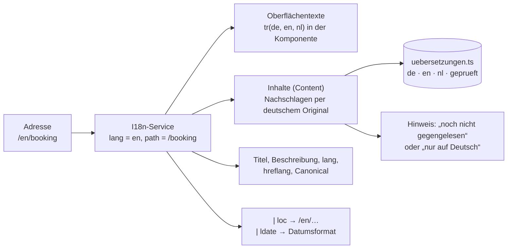

| Baustein | Aufgabe |
|---|---|
| `src/app/i18n.ts` | Sprache aus der Adresse (`I18n.lang`), `tr(de, en, nl)` für typisierte Wörterbücher, Pipes `loc` (Links) und `ldate` (Datumsformate je Sprache) |
| Wörterbücher in den Komponenten | Feste Texte der Oberfläche. Englisch und Niederländisch müssen exakt die Form der deutschen Fassung haben, sonst bricht der Build ab. |
| `src/app/data/uebersetzungen.ts` + `src/app/content.ts` | Inhalte aus `band.service.ts` und `technik.json` (Bios, Historie, Bildtexte, Freunde, Technik). Schlüssel ist der deutsche Text: Ändert er sich, erscheint wieder das Original mit Hinweis, bis neu übersetzt ist. Die Tabelle lädt nur für `/en` und `/nl` (`canMatch` wartet darauf), deutsche Seiten bleiben schlank. |
| `geprueft: { en, nl }` | Markiert gegengelesene Übersetzungen. Ungeprüfte Inhalte tragen auf der Seite den Hinweis „noch nicht gegengelesen“. Den Stand zeigt der Backstage. |
| Gegenlesen im Backstage | `/backstage/uebersetzungen`: Original und Übersetzung nebeneinander, Korrektur und Freigabe im Browser. `src/app/data/uebersetzungen-patch.ts` setzt die Entscheidungen in den aktuellen Quelltext von GitHub ein (nur die betroffenen Einträge) – oder sie gehen als Nachricht an die Band. |
| Sprachhinweis | `src/app/sections/sprach-hinweis.ts`: Bevorzugt der Browser eine andere unserer Sprachen, erscheint einmalig ein Hinweis in dieser Sprache (keine automatische Umleitung). Eine gewählte Sprache merkt sich das Gerät (`bn-sprache`). |
| Rechtstexte | Impressum und Datenschutz liegen übersetzt vor, mit dem Hinweis, dass nur die deutsche Fassung verbindlich ist. |
| SEO | `scripts/seo.mjs` schreibt strukturierte Daten je Sprache und eine Sitemap mit allen drei Fassungen samt `hreflang`. |

Bewusst **eine** Anwendung mit Wörterbüchern statt Angulars `@angular/localize` mit einem Build je Sprache: Fotos,
PDFs, Service Worker und Prüfungen gibt es so nur einmal, und ein Sprachwechsel braucht kein Neuladen.

## 6. Datenmodell – eine Quelle für alles

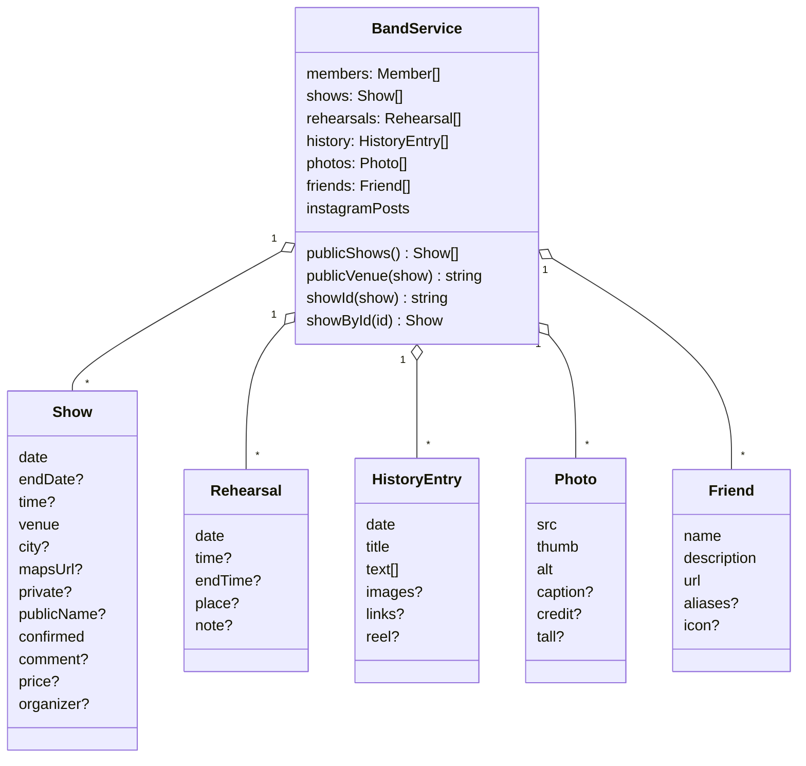

**Sichtbarkeitsregeln für Auftritte:**

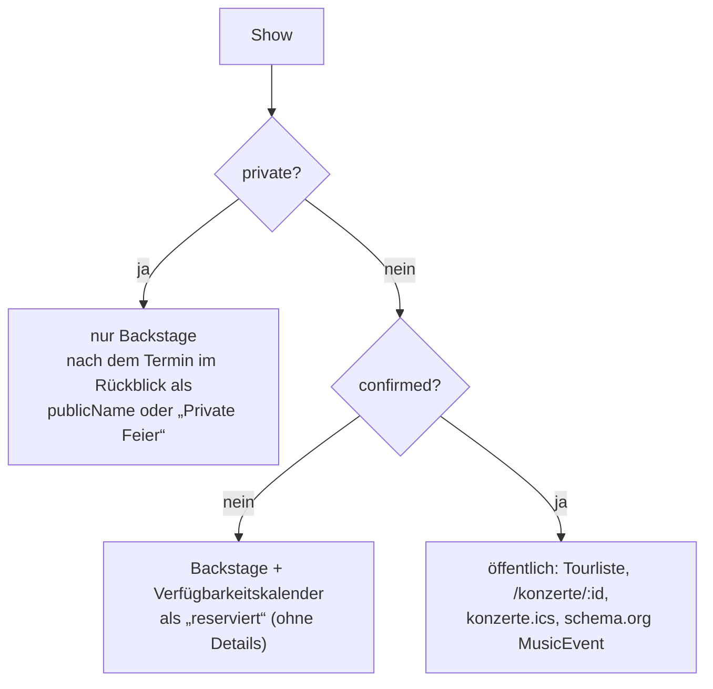

**Weitere Datenquellen:**

| Datei | Inhalt | Entsteht durch |
|---|---|---|
| `src/app/data/repertoire.json` | Songs mit Interpret, Jahr und Dauer | `scripts/sync-repertoire.mjs` (Spotify, wöchentlich) |
| `src/app/data/technik.json` | Bühnenplan, Kanäle, Geräte, Strom | von Hand oder per Bühnenplan-Editor im Backstage; daraus entstehen Seite, Rider- und Bühnenplan-PDF (bei jedem Deploy neu) |
| `src/app/data/faq.ts` | Häufige Fragen in DE, EN und NL | von Hand; auch als FAQPage-JSON-LD ausgegeben |
| `src/app/data/version.json` | Versionsnummer im Footer | `scripts/write-version.mjs` aus dem letzten Release-Tag |
| `public/data/orte.json` | Orte, Postleitzahlen, Ortsteile, ferne Städte | GeoNames (CC BY 4.0) plus Handpflege; wird erst beim Tippen geladen |

**Wer liest `band.service.ts`?**

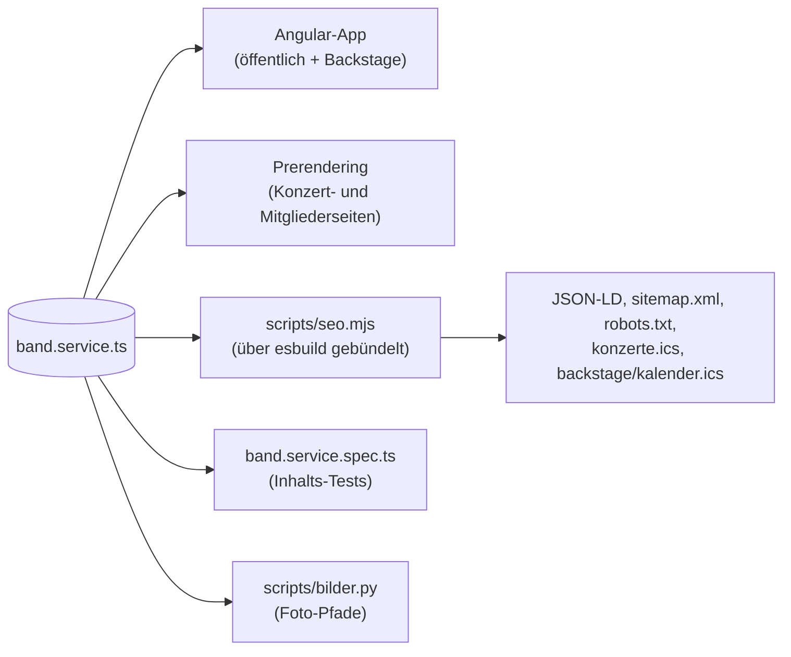

Das SEO-Skript bündelt `band.service.ts` mit esbuild und ersetzt dabei `@angular/core` durch einen Stub. So nutzen Build-Skripte
exakt dieselben Daten und Regeln wie die App, ohne Kopie.

## 7. Öffentliche Website

```mermaid
flowchart TB
  HOME["Startseite /"] --> HERO["Hero mit Countdown<br/>zum nächsten Gig"]
  HOME --> BAND["Die Band → /band/:slug"]
  HOME --> TOUR["Tour: kommende + vergangene Auftritte<br/>→ /konzerte/:id"]
  HOME --> LL["Zuletzt live"]
  HOME --> IGF["Neu auf Instagram<br/>(Zwei-Klick)"]
  HOME --> BT["Booking-Teaser → /booking"]

  BOOK["/booking (+ EN, NL)"] --> AV["Verfügbarkeitskalender"]
  BOOK --> ANF["Anfrage-Assistent<br/>(3 Schritte → mailto)"]
  BOOK --> ENT["Entfernungs-Check<br/>(orte.json)"]
  BOOK --> FAQ["FAQ, Angebot, Technik-Rider"]

  KON["/konzerte/:id"] --> ICS["Kalender, Teilen, Anfahrt"]
  KON --> REC["Rückblick aus history<br/>(vergangene Konzerte)"]

  WUN["/wunsch"] --> SW["Song aus repertoire.json<br/>→ Instagram-Nachricht oder E-Mail"]
```

- Die **Startseite** lädt ihre Abschnitte mit `@defer (on immediate; hydrate on viewport)`. Das HTML ist sofort da,
  JavaScript wird erst beim Hinscrollen aktiv.
- Alle öffentlichen Seiten gibt es auf Deutsch, Englisch und Niederländisch (siehe [Mehrsprachigkeit](#mehrsprachigkeit)).
- **Kalender-Abos:** `konzerte.ics` (öffentlich) und `backstage/kalender.ics` (alle Auftritte und Proben). Der
  Abo-Button nutzt `webcal://`, auf Android den Google-Kalender, dazu „Adresse kopieren“ für Outlook.
- **Generierte Downloads** in `public/presse/`: Pressekit (PDF/ZIP), Technik-Rider, QR-Karte, Wunschbox-Schild.
  Python-Skripte erzeugen sie und sie werden eingecheckt.

## 8. Backstage

Der Backstage (`/backstage`, `noindex`, über ein Easter Egg erreichbar) ist das Werkzeug der Band: Übersicht, Planung
und Hilfen am Abend des Auftritts. Er ist **kein geschützter Bereich**. Alle Termindaten stecken ohnehin im öffentlichen JavaScript.

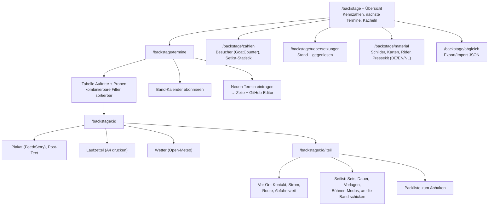

**Zustand im Browser:** Ohne Server speichert jedes Gerät seine Eingaben selbst in `localStorage`:

| Schlüssel | Inhalt |
|---|---|
| `bn-setlist-<id>` | Setlist eines Auftritts |
| `bn-setlist-vorlagen` | gespeicherte Setlist-Vorlagen |
| `bn-packliste-<id>` | abgehakte und eigene Packlisten-Punkte |
| `bn-vorort-<id>` | Vor-Ort-Angaben und Anfahrt |
| `bn-backstage-filter` | gewählte Filter der Tabelle |
| `bn-uebersetzung-pruefung` | noch nicht übernommene Entscheidungen beim Gegenlesen |
| `bn-sprache` | ausdrücklich gewählte Sprache (dann kein Sprachhinweis mehr) |
| `bn-chunk-reload` | Schutz gegen Neulade-Schleifen nach einem Deploy |

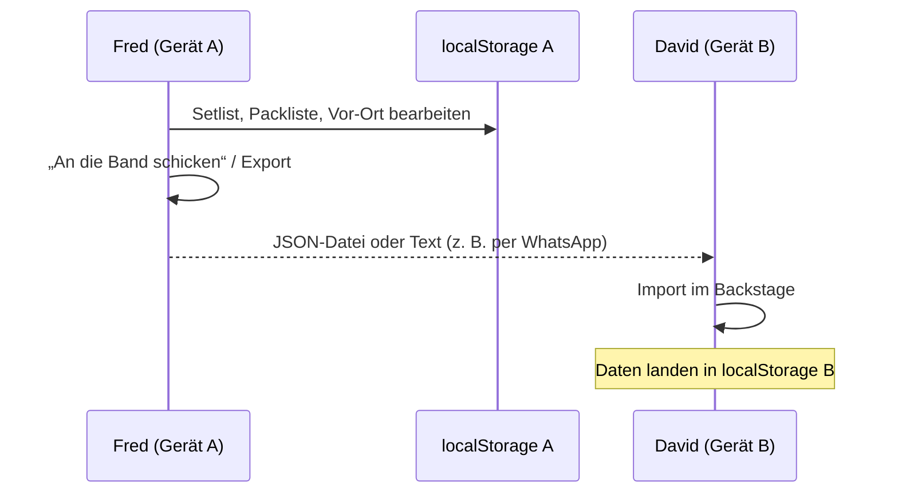

Geteilt wird bewusst von Hand (Export/Import, Teilen-Text). Eine automatische Synchronisierung bräuchte einen Server.

**Termine eintragen:** Das Formular `termin-formular.ts` erzeugt eine TypeScript-Zeile im Stil von `band.service.ts`
und öffnet die Datei im GitHub-Editor. Erst der Commit macht den Termin wirksam (Kapitel 13).

## 9. Progressive Web App und Offline

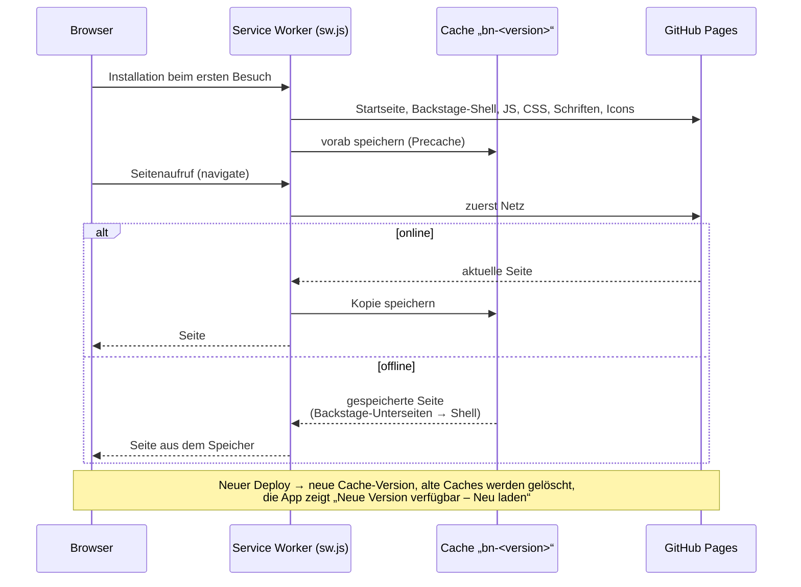

- `scripts/build-sw.mjs` erzeugt `sw.js` aus `scripts/sw/sw-template.js` mit Version und Dateiliste des Builds.
- `public/site.webmanifest`: `display: standalone`, maskierbares Icon, Verknüpfungen (Konzerte, Booking, Repertoire).
- `src/app/pwa.ts`:
  - Install-Button im Footer, auf iOS ein Hinweis „Zum Home-Bildschirm“
  - Update-Hinweis bei `controllerchange`
  - Update-Prüfung, wenn die App aus dem Hintergrund zurückkommt
- Damit funktioniert der Backstage **auf dem Gig ohne Netz**, mit dem zuletzt geladenen Stand.

## 10. Build- und Deploy-Pipeline

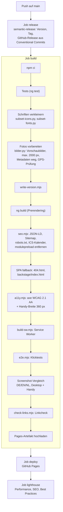

Weitere Workflows:

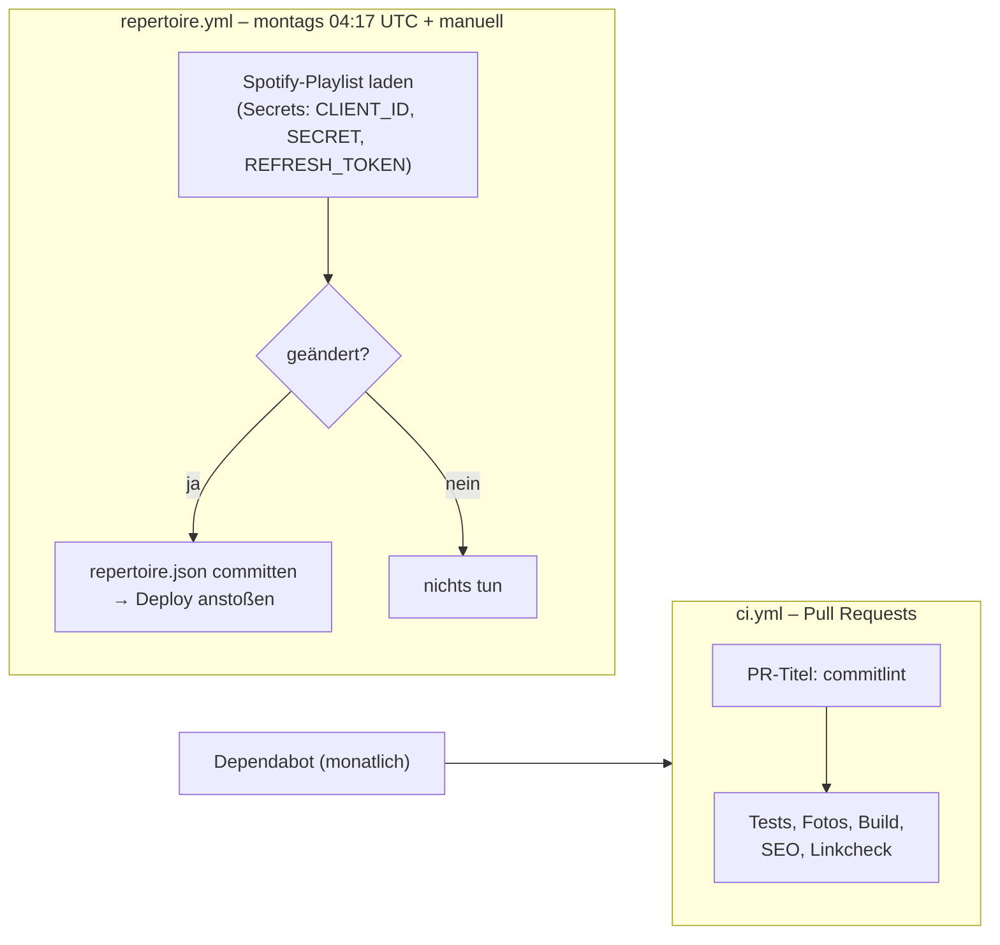

**Versionierung:** Commit-Typen nach Conventional Commits. `feat` ergibt eine Minor-Version, `fix`, `perf` und `content`
eine Patch-Version, die übrigen keine. Die Versionsnummer steht im Footer.

## 11. Qualitätssicherung

| Prüfung | Werkzeug | Was sie abfängt |
|---|---|---|
| Inhalts-Tests | `band.service.spec.ts`, `calendar.spec.ts` (Vitest) | Ungültige Daten und Uhrzeiten, „bis“ vor „von“, doppelte Backstage-IDs, private Namen öffentlich, fehlende Alt-Texte, falsche Verweise in `technik.json`, Kalender-Erinnerungen |
| TypeScript-Build | `ng build` | Syntaxfehler (fehlendes Komma oder Klammer), Größenbudgets |
| Fotos | `scripts/bilder.py` | Eingetragenes Bild fehlt, GPS-Standort im Bild |
| Barrierefreiheit | `scripts/a11y.mjs` (Playwright + axe-core) | WCAG-2.1-AA-Verstöße auf allen Seiten; Überlauf auf 360 px Breite mit +15 % Schrift |
| Klicktests | `scripts/e2e.mjs` (Playwright) | Wichtige Abläufe: Konzertliste, Anfrage, Entfernungs-Check, Repertoire-Suche, Menü, Backstage-Filter, Setlist, Vor Ort, Export/Import, Kalender und Service Worker |
| Screenshot-Vergleich | `tests/visual` (`@playwright/test`, `toHaveScreenshot`) | Verrutschte Layouts: Startseite, Booking, Technik, Presse, Impressum und Fehlerseite in DE/EN/NL auf Desktop und Handy gegen Referenzbilder (über 2 % Abweichung stoppt den Deploy). Wechselnde Inhalte sind abgedeckt, die Referenzbilder entstehen per Workflow „Screenshots aktualisieren“ auf dem Runner. |
| Links | `scripts/check-links.mjs` | Defekte interne Links und Bilder (externe Links nur als Warnung) |
| Lighthouse | Lighthouse CI nach dem Deploy | Rückschritte bei Performance, SEO und Best Practices |
| Commit-Format | commitlint (PR-Titel) | Saubere Versionen und Release Notes |

Alle Browser-Prüfungen nutzen denselben kleinen Testserver (`scripts/lib/static-server.mjs`) gegen den fertigen Build.

## 12. Externe Dienste und Datenschutz

| Dienst | Wofür | Wann | Personenbezug |
|---|---|---|---|
| GitHub Pages | Hosting | jeder Aufruf | Server-Logs bei GitHub |
| GoatCounter | Reichweitenmessung; Besucherzahlen im Backstage | Seitenwechsel (ohne Backstage) | ohne Cookies und ohne IP-Speicherung; öffentlich nur Summen |
| Instagram | Reels und Beiträge, Wunschbox-Nachricht | erst nach Klick | Datenübertragung an Meta erst nach Zustimmung durch Klick |
| Spotify Web API | Repertoire-Sync | nur in GitHub Actions | keiner (Besucher sprechen Spotify nicht an) |
| Open-Meteo | Wettervorhersage | nur im Backstage | Koordinaten des Auftrittsorts |
| Google Maps / Kalender | Anfahrt, Kalender-Abo | nur als Link | erst beim Öffnen |

Die Datenschutzerklärung (`src/app/pages/datenschutz.ts`) beschreibt GoatCounter, Instagram-Einbettungen und den
Offline-Speicher der App. Schriften und Icons werden selbst gehostet, es gibt keine Google-Fonts-Abfragen.

## 13. Pflege-Workflow

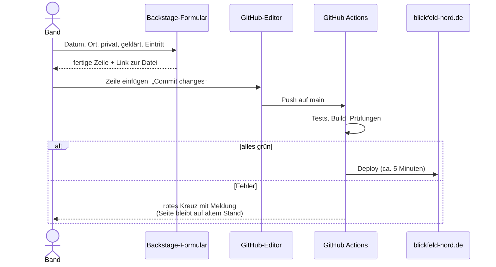

Die ausführliche Anleitung mit Beispielen steht in [PFLEGE.md](PFLEGE.md).

## 14. Performance

- **Vorgerenderte Seiten:** Der Inhalt ist ohne JavaScript sichtbar. Die Hydration läuft inkrementell beim Hinscrollen.
- **Startbild:** `fetchpriority="high"`, feste Maße, Varianten mit 800, 1200 und 2000 px.
- **Kleine Schriften:** Icon-Schrift und Textschriften enthalten nur die benutzten Zeichen.
- **Galerie-Vorschauen** in 480, 720 und 900 px, gesteuert über `srcset` und `sizes`.
- **Lazy Loading:** pro Route, Ortsverzeichnis erst beim Tippen, Instagram erst nach Klick.
- **Budgets** in `angular.json`: Bundle max. 2 MB (Warnung ab 1 MB); Komponenten-Styles max. 8 kB (Warnung ab 4 kB).

## 15. Architekturentscheidungen

| Entscheidung | Begründung | Konsequenz |
|---|---|---|
| Statische Seite auf GitHub Pages statt CMS oder Server | Kostenlos, wartungsarm, sicher (keine Angriffsfläche), schnell | Änderungen laufen über Git; Formulare ohne Server (mailto, Instagram) |
| Inhalte als TypeScript statt JSON oder CMS | Typprüfung beim Build, eine Datei für alles, Tests direkt auf den Daten | Pflege im GitHub-Editor; das Termin-Formular senkt die Hürde |
| Prerendering für alles Öffentliche | Gute Ladezeit und SEO ohne laufenden Server | Neue Inhalte brauchen einen Build (passiert automatisch) |
| Backstage nur clientseitig, ohne Login | Kein Server für Authentifizierung; private Daten nicht als HTML indexieren | Kein echter Zugriffsschutz – nichts Vertrauliches eintragen |
| Mehrsprachigkeit über Wörterbücher in einer Anwendung (statt `@angular/localize`) | Eine Ausgabe für Fotos, PDFs, Service Worker und Prüfungen; fehlende Übersetzungen fallen beim Build auf | Alle drei Sprachen stecken im JavaScript (wenige KB) |
| Gerätedaten in `localStorage` plus Export/Import | Funktioniert offline auf dem Gig, ohne Konto | Keine automatische Synchronisierung zwischen Band-Mitgliedern |
| Generierte Assets (PDFs, Vorschaubilder) beim Build erzeugt | Vorschaubilder und alle PDFs (Pressekit, Rider, Bühnenplan, QR-Karte, Wunschbox) sollen der Band keine Arbeit machen und entstehen bei jedem Deploy neu | Deploy braucht Python und ein paar Sekunden mehr; die eingecheckten PDFs sind nur der Stand für lokales Arbeiten |
| Prüfungen als Deploy-Bremse | Pflege durch Nicht-Entwickler ohne Risiko | Ein Fehler hält den Deploy an, bis er behoben ist |

## 16. Grenzen und bekannte Einschränkungen

- **Kein Zugriffsschutz im Backstage.** Wer die Adresse kennt, sieht alle Termine. Alles im Repo gilt als öffentlich.
- **Keine Live-Synchronisierung** von Setlist, Packliste und Vor-Ort-Daten zwischen Geräten.
- **Neue Inhalte erst nach dem Deploy** (einige Minuten); installierte Apps übernehmen sie beim nächsten Öffnen.
- **GoatCounter-Besucherzahlen** brauchen die Freigabe des öffentlichen Zählers und sind bis zu einige Stunden gepuffert.
- **Externe Abhängigkeiten zur Laufzeit** (GoatCounter, Open-Meteo, Instagram) sind optional. Fällt ein Dienst aus,
  zeigt die Seite einen Hinweis statt eines Fehlers.
- **Release-Schritt:** semantic-release schreibt Tags und Git-Notes. Lehnt GitHub den Push der Notes ab, bricht der Job
  ab, obwohl der Tag bereits existiert. Ein „Re-run failed jobs“ setzt den Deploy fort.
